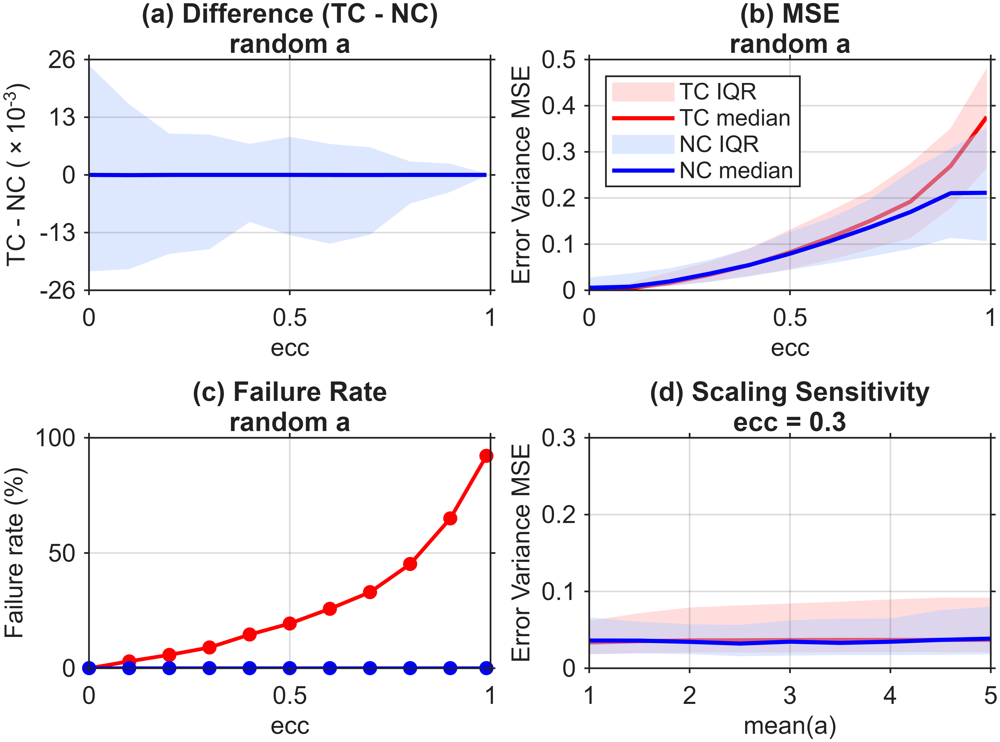
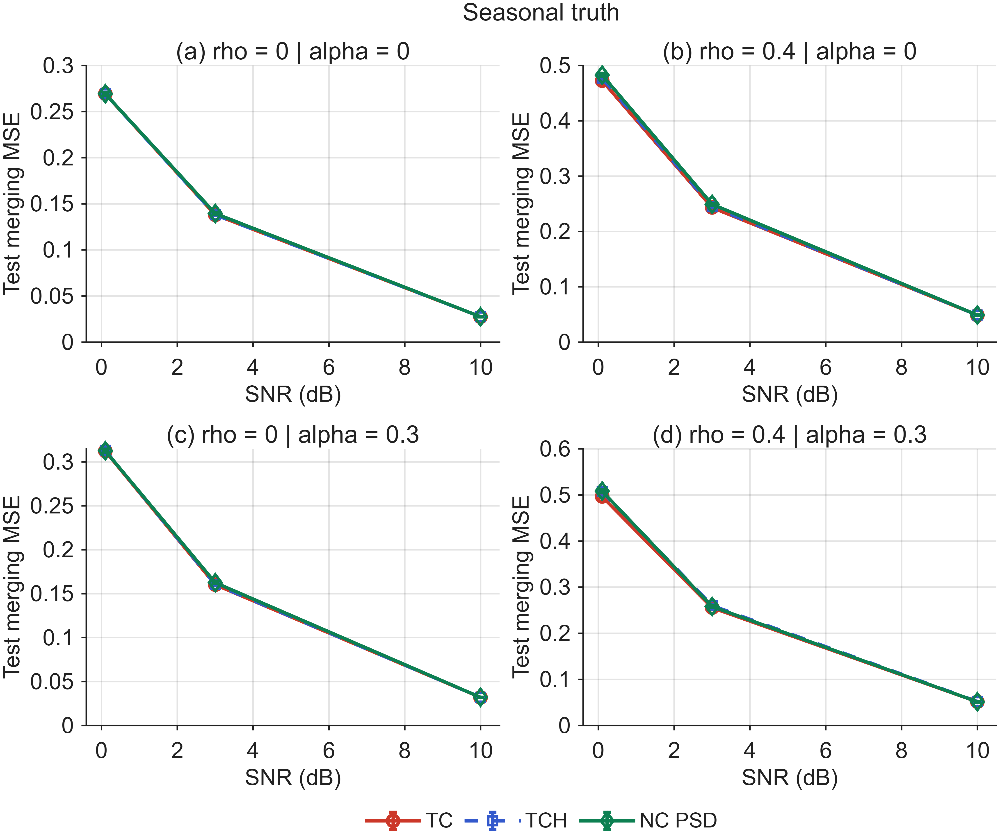

# NC-public

MATLAB code for **N-Tuple Collocation for Reference-Free Uncertainty Estimation from Multi-Source Hydrological Data: Beyond Triple Collocation and Three-Cornered Hat**, by Hung T. Pham and Seokhyeon Kim.

The repository includes scripts for reproducing the synthetic covariance experiments, TC–NC and TCH–NC comparisons, NC sensitivity tests, downstream weighted-averaging experiments, graphical abstract, and supplementary feasibility diagnostics. All input samples are generated internally. The repository contains the code, MATLAB-generated figure gallery and compact numeric summaries. Full experiment workspaces remain local under results/.

For direct estimation, start with [Using NC.m](#using-ncm). For the paper experiments and figure gallery, see [the full workflow](#run-the-full-experiment-workflow) and [generated figures](#generated-figure-gallery).

## Citation

Pham, H.T. & Kim, S. (2026). N-Tuple Collocation for Reference-Free Uncertainty Estimation from Multi-Source Hydrological Data: Beyond Triple Collocation and Three-Cornered Hat. *Journal of Hydrology* (accepted).

Volume, issue, pages/article number, and DOI will be added when assigned. Machine-readable citation metadata are provided in [CITATION.cff](CITATION.cff).

## Requirements

- MATLAB R2025b was used for verification. Earlier releases have not been validated.
- The estimators, paired synthetic experiments, numerical checks, feasibility diagnostics, and graphical abstract use base MATLAB. No Optimization Toolbox is required.
- The four original experiment scripts require Statistics and Machine Learning Toolbox for their percentile/boxplot plotting functions.
- No external datasets, personal paths, or network drives are required.

## Using NC.m

`NC.m` estimates an error covariance matrix from the covariance of collocated products, without requiring observations of the true signal. It can be called directly; the experiment runner is optional.

```matlab
[Ehat, thetaHat, rho2Hat, info] = NC(Q);       % default settings
[Ehat, thetaHat, rho2Hat, info] = NC(Q, opts); % optional settings
```

### Input and a runnable example

`Q` is a **finite, real, p-by-p covariance matrix**, not a matrix of time series. It should be symmetric and PSD, with nonnegative diagonal entries; input repair is described below. For observations `X`, arrange rows as matched samples and columns as products, then calculate `Q = cov(X)`. Three or more products are recommended. The code also accepts two products, for which the decomposition is underdetermined.

Run this self-contained example from the repository root in MATLAB. The normal random samples are used only to construct the example; NC itself uses the covariance matrix.

```matlab
addpath(pwd,'-begin');
rng(123);
n = 2000;
y = randn(n,1);                 % latent signal, known only in this example
a = [0.8; 1.0; 1.2; 1.1];      % product gains
L = [0.6 0   0   0; ...
     0.2 0.7 0   0; ...
     0.1 0.2 0.5 0; ...
     0   0.1 0.2 0.8];
errors = randn(n,4)*L';         % correlated errors; covariance is L*L'
X = y*a' + errors;              % 2000 observations x 4 products
Q = cov(X);

[Ehat, thetaHat, rho2Hat, info] = NC(Q);
errorVariance = diag(Ehat);
errorSD = sqrt(max(errorVariance,0)); % guard against roundoff near zero
disp(table((1:4)',errorSD,rho2Hat, ...
    'VariableNames',{'Product','EstimatedErrorSD','EstimatedSignalR2'}));
fprintf('Residual PSD feasible: %d; decomposition error: %.3g\n', ...
    info.feasiblePSD,info.decompositionRelativeError);
```

The fitted values need not recover the generating covariance `L*L'` exactly: the covariance alone does not uniquely determine the physical signal/error allocation.

For your own data, first align timestamps and spatial support, apply quality control, and use the same valid observations for all products:

```matlab
validRows = all(isfinite(X),2);
Xcommon = X(validRows,:);
assert(size(Xcommon,1)>1,'At least two common observations are required.');
Q = cov(Xcommon);
[Ehat, thetaHat, rho2Hat, info] = NC(Q);
```

`cov` removes the sample means. Use enough common observations to estimate a representative covariance; the two-observation assertion is only a computational minimum. Pairwise deletion can produce a covariance assembled from different samples and may make it indefinite. NC does not perform time matching, quality control, bias correction, or detrending for you.

### What the outputs mean

- `Ehat` (`p x p`): estimated error covariance. `diag(Ehat)` contains error variances; off-diagonal entries contain estimated error cross-covariances and can be positive or negative. Covariance units follow the input products; error SD has the corresponding product units.
- `thetaHat` (`p x 1`): fitted signal amplitudes, combining each product's gain and the latent signal standard deviation. This is neither a recovered signal time series nor a vector of merging weights. Its overall sign is ambiguous because `thetaHat` and `-thetaHat` give the same rank-one covariance.
- `rho2Hat` (`p x 1`): `thetaHat(i)^2 / Qused(i,i)`, the estimated squared signal correlation under the model. `Qused` is the symmetrized, possibly PSD-repaired input. A zero-variance product gives `NaN`. These values are model-based estimates, not correlations measured against an observed truth.
- `info`: optimization, input-repair and residual-feasibility diagnostics. Inspect these alongside the estimates, as described below.

## How NC works

For centered products, the model is

$$
x_i = a_i y + e_i, \qquad \operatorname{Cov}(y,e_i)=0,
$$

so their covariance is decomposed as

$$
Q = \sigma_y^2 aa^{\mathsf T} + \Sigma_e
  = \theta\theta^{\mathsf T} + \Sigma_e,
\qquad \theta = \sigma_y a.
$$

NC selects a rank-one common-signal component and assigns the remaining covariance to the error component. The current implementation uses two stages:

1. **Fit the signal component.** Minimize the absolute off-diagonal residuals with diagonal bounds:

   $$
   \min_{\theta}\ \sum_{i\ne j}|Q_{ij}-\theta_i\theta_j|,
   \qquad |\theta_i|\leq\sqrt{Q_{ii}}.
   $$

   The bounds ensure nonnegative residual diagonal entries. The solver uses multiple spectral initializations, projected subgradient steps and a backtracking line search, retaining the lowest objective found. It stops when improvement remains below its threshold for the configured patience, or when the iteration cap is reached. This nonconvex fit has no guarantee of finding a global optimum.

2. **Make the residual covariance PSD.** With `enforcePSD=true` (the default), project the fitted vector into the numerical range of `Q`, then shrink it if needed to satisfy

   $$
   \theta^{\mathsf T}Q^{\dagger}\theta \leq 1.
   $$

   Here `Q` is PSD and the dagger denotes its pseudoinverse. Together with the range condition, this makes `Ehat = Q - thetaHat*thetaHat'` PSD within numerical tolerance. A small interior margin handles floating-point roundoff. The code adjusts the signal vector rather than independently clipping the residual matrix, preserving the covariance decomposition. This step can change the L1 objective; `info` records that change.

Before fitting, NC symmetrizes the input, divides it by one positive scalar for numerical conditioning, and optionally clips negative input eigenvalues to zero. Outputs are converted back to the input covariance units. This global normalization does not standardize individual products. Choose product units deliberately: rescaling one product changes the relative weighting of covariance residuals in the L1 fit. If input repair occurs, the decomposition refers to the repaired covariance, rather than the original matrix.

The objective favors a small absolute off-diagonal error allocation; error cross-covariances are allowed in the residual. Interpreting the result requires a meaningful common latent signal and signal–error orthogonality. The fitted allocation is a regularized estimate: even with three or more products, correlated errors can admit multiple physically different decompositions. Numerical feasibility alone does not establish unique physical error identification or superior accuracy for every dataset.

### Options and diagnostics

For example, add reproducible random starts to the default spectral starts:

```matlab
opts = struct('nStarts',4,'nRandomStarts',2,'randomSeed',42,'verbose',true);
[Ehat, thetaHat, rho2Hat, info] = NC(Q,opts);
```

Frequently used options and their defaults are:

- `nStarts = min(4,p)`: requested spectral starts, capped at `p`. Zero starts are removed when nonzero starts exist, so `info.nStarts` reports the actual total used.
- `nRandomStarts = 0`, `randomSeed = 1`: additional random starts, generated with a local random stream.
- `maxIters = 2000`, `minIters = 20`, `patience = 30`: iteration cap, earliest stopping iteration and stagnation patience for each start.
- `enforcePSD = true`: apply the residual PSD feasibility map. Set to `false` only for a raw diagnostic; the residual matrix can then be indefinite despite its nonnegative diagonal.
- `repairInputPSD = true`: repair negative input eigenvalues. Setting it to `false` rejects materially indefinite input, allowing only deviations within the numerical tolerance.
- `psdTol = 1e-10`: relative feasibility tolerance in normalized covariance units.
- `verbose = false`: print a short fit summary when enabled.

Other step-size and objective-tolerance controls are defined in the parameter block of [NC.m](NC.m). Changing numerical settings can change the selected solution.

Useful diagnostics include:

- `inputPSDRepaired`, `inputPSDRelativeChange`: whether and how much the input covariance changed.
- `objectiveBeforePSD`, `objective`, `objectiveChangePSD`: off-diagonal L1 loss before and after the residual feasibility map, in the input covariance units.
- `thetaScalePSD`, `thetaRelativeChangePSD`, `psdRepairApplied`: shrinkage and total signal-vector adjustment during that map.
- `feasiblePSD`, `minErrorCovEigenvalue`, `decompositionRelativeError`: residual feasibility and preservation of the decomposition.
- `startInfo`: initial/final objective, iteration count and stopping flag for each start. A `converged` flag records the stopping rule; it is not a global-optimality certificate.
- `p2Underdetermined`, `physicalErrorIdentified`: structural interpretation flags. The latter is always `false`; NC does not certify physical error identification.

### Using the estimated covariance for merging

`WA.m` computes unit-sum error-covariance weights. Its inputs must be on a common unbiased signal scale; unequal product gains do not satisfy that condition automatically. For the toy example above, the gains are known, so first calibrate the products and re-estimate their error covariance on that scale:

```matlab
Xcalibrated = Xcommon ./ a';    % possible here because the toy gains are known
[Ecalibrated,~,~,ncInfo] = NC(cov(Xcalibrated));
[weights,waInfo] = WA(Ecalibrated);
merged = Xcalibrated*weights;
disp(weights);                 % sum is one; individual weights may be negative
```

For real observations, establish an appropriate calibration separately. `WA.m` applies an explicit relative eigenvalue floor (default `1e-8`) before solving for weights; a PSD covariance can still be singular and require this SPD safeguard. Inspect `waInfo.regularized`, `waInfo.relativeChange` and `waInfo.covarianceUsed`. This numerical conditioning is separate from NC's PSD feasibility map.

## Run the full experiment workflow

Open this folder in MATLAB and run the dependency check. A call with no arguments performs this check only:

```matlab
Run_All_Synthetic;
```

A reduced-replication software check explicitly starts calculations and writes a new timestamped folder under `results/`:

```matlab
options = struct('mode','run','nMC',2,'nSensitivity',2,'nLegacy',2, ...
    'runLegacy',true,'makePublicationOutputs',true);
check = Run_All_Synthetic([],options);
```

Reduced-replication outputs are software checks and must not be used as the reported Monte Carlo results. To reproduce the full synthetic design, explicitly request the production run:

```matlab
runInfo = Run_All_Synthetic([],struct('mode','run'));
saved = runInfo.outputRoot;
```

This uses 500 replicates for each original experiment and each of the 36 paired scenarios, plus 100 sensitivity realizations. Runtime depends on the computer; the runner records stage timings and progress. The workflow is sequential and does not require Parallel Computing Toolbox. Set `runLegacy=false` to run only the base-MATLAB paired/sensitivity suite. A new or empty output folder is required; existing runs are not overwritten or resumed.

The options `nMC`, `nSensitivity`, `nLegacy`, `runLegacy`, `makePublicationOutputs`, and `invisibleFigures` are centralized in `Run_All_Synthetic.m`. Changing replication counts or the scientific configuration creates a different experiment.

## Generated figure gallery

[View all MATLAB figures and PDF downloads](figures/README.md). The gallery contains the full current-code production results: 500 main/original-design replicates, 100 sensitivity replicates, and 1,000 supplementary diagnostic pixels. The small CSV tables and run configuration are included; MAT workspaces, logs, editable FIG files and full replicate records remain local.

To calculate and rebuild the gallery:

```matlab
addpath(pwd,'-begin'); % run this from the repository root
runInfo = Run_All_Synthetic([],struct('mode','run'));
cd(runInfo.outputRoot); % record this directory before running the script below
Figure_Supplementary_NC_PSD_Diagnostic; % script may clear workspace variables
Export_Public_Figures(pwd,fullfile(pwd,'public_gallery')); % new output folder
```

`Export_Public_Figures` reads the saved editable figures and summaries. It does not rerun covariance fits. It writes 600-dpi PNG/vector PDF (preserving the original 300-dpi graphical abstract), removes repeated method legends and axes toolbars, and saves source hashes and settings. Supply a new output directory as its second argument when a gallery already exists. These current-code figures can differ from the earlier submitted manuscript figures; the existing submission documents are not overwritten by this run.





## Entry points and output figures

The integrated runner executes the following scripts in isolated stage folders and saves their workspaces and figures. They can also be run individually from a separate output working directory with the repository on the MATLAB path.

- `Sim_TC_vs_NC.m`: original covariance-level TC–NC comparison; `Sim_TC_vs_NC_results.png` (design corresponding to original Figure 1; current NC).
- `Sim_TCH_vs_NC.m`: original TCH–NC comparison and scaling test; `Sim_TCH_vs_NC_results.png` (design corresponding to original Figure 2; current NC).
- `Test_NC_Sensitivity.m`: original SNR, product-number, and sample-length tests; `Test_NC_Sensitivity_results.png` (design corresponding to original Figure 3; current NC).
- `Sim_WA_Comparison.m`: original covariance-based weighted-averaging experiment; `Sim_WA_Comparison.png` (design corresponding to original Figure 4; current NC).
- `run_revision_synthetic(nMC,outDir)`: the additional paired stationary/seasonal experiments with independent training/test samples, known-covariance and equal-weight controls, and raw/PSD diagnostics.
- `run_revision_identifiability(nMC,outDir)`: exact p=2/p=3 decomposition examples and six-initialization/five-floor sensitivity tests.
- `Build_Synthetic_Revision_Artifacts(mainDir,sensitivityDir,newOutputDir)`: generates tables and publication figures from completed CSV outputs, without fitting the models again.
- `Export_Public_Figures(runDir,newOutputDir)`: collects the production figures and compact tables into a public gallery without refitting.
- `Draw_JoH_Graphical_Abstract(outputDir)`: generates the graphical abstract in PNG, vector PDF, and editable MATLAB FIG. This entry point requires no simulations.
- `Figure_Supplementary_NC_PSD_Diagnostic.m`: optional original synthetic-pixel PSD diagnostic; `FigS_NC_PSD_Diagnostic.png/pdf`. Its same-sample validation proxy is a numerical diagnostic, distinct from the independent-test merging analysis.
- `Test_Revision_Core(outputDir)`: 16 numerical checks, including PSD feasibility, decomposition preservation, and weighted-averaging behavior.

All NC experiments call the single current `NC.m` implementation. The four covariance-level scripts retain the original experimental designs, but now use the current NC optimizer and its default residual PSD feasibility map. Their newly calculated values and figures can differ from the originally submitted Figures 1–4. For the historical pre-revision NC implementation and experiment sources, see source commit `1cb6c536a2f67724b4d23942228a6f100c00474e` (8 July 2026) in `steelpl/n-tuple-collocation`; the current file tree contains no separate submitted NC estimator. `WA_Submitted.m` remains the original ridge/backslash WA rule for the covariance-level WA comparison; additional paired experiments use current `WA.m`. TC, TCH and the covariance generator are unchanged from that source. The WA plotting script includes a display-only correction that preserves missing groups and method colors.

The paired experiments call the current `NC.m`/`WA.m`, add unit-gain independent-test comparisons, and retain every attempted realization. Their numerical values answer different experimental questions and should not be interchanged with the original figures. All current stages use NC.m; the covariance-level WA experiment retains WA_Submitted.m, while the paired experiment uses current WA.m.

The paired-experiment figure filenames in `09_publication_artifacts/` are:

- `Figure_R1_Variance_RMSE_alpha_0`: variance accuracy with signal–error orthogonality.
- `Figure_R1_Variance_RMSE_alpha_0p3`: deliberate signal–error correlation diagnostic.
- `Figure_R2_Heldout_Merging`: independent-test weighted-averaging MSE.
- `Figure_R3_Stress_Feasibility_and_PSD_Cost`: severe-correlation feasibility and PSD-map cost.
- `Figure_R4_Initialization_and_Eigenfloor` and `Figure_R4b_Initialization`: numerical sensitivity.
- `Figure_R5_Merging_Controls`: equal-weight and known-error-covariance controls.
- `Figure_R6_Paired_Seasonal_Change`: paired seasonal-minus-stationary differences.
- `Graphical_Abstract_NC`: conceptual graphical abstract.

`R1`–`R6` are filename identifiers, not final manuscript numbering. Supplementary CSVs include complete denominators, method contrasts, initialization/floor settings, and the p=2/p=3 nonuniqueness examples. Figure exports use MATLAB throughout: the paired figures use 600-dpi PNG, vector PDF and editable FIG; the graphical abstract uses 300-dpi PNG, vector PDF and FIG. `JoHFigureStyle.m` controls the common paired-figure fonts, palette and single legend.

To audit or regenerate figures from a completed integrated run:

```matlab
Run_All_Synthetic(saved,struct('mode','audit'));
p = Run_All_Synthetic(saved,struct('mode','postprocess'));
figureDir = p.publication.artifactDir;
```

To generate only the graphical abstract:

```matlab
Draw_JoH_Graphical_Abstract(fullfile(pwd,'results','graphical_abstract'));
```

## Reproducibility and interpretation

The original four scripts use seed 123. The paired suite uses base seed 20260917, and the sensitivity suite uses 20260918, each advanced by replicate index. Core numerical checks use 83955; the optional original PSD diagnostic uses 20260707. Configurations, source snapshots/hashes, all attempts, summaries, stage timings and the validation report are saved in each integrated run. Full source snapshots remain local. The public gallery records source SHA-256 values and the executed experiment settings.

The paired suite has 36 scenarios, 1095 training and 1095 independent test days, SNR 0.1/3/10 dB, base error correlations 0/0.4/0.99, and signal–error correlation parameters 0/0.3. Accuracy summaries are conditional on available estimates; failure rates retain attempted denominators. Pairwise contrasts use common valid realizations. Confidence intervals quantify Monte Carlo uncertainty across realizations.

The [method and diagnostic guidance above](#how-nc-works) applies throughout the experiments. The supplied TCH implementation is the repository penalty-optimization variant, and its first reconstructed covariance output is used by the experiment scripts.

## License

The original MIT license is retained in `LICENSE`.
