# MATLAB-generated NC figures

Full current-code execution: 500 main and original-design replicates; 100 sensitivity replicates; 1,000 supplementary diagnostic pixels. MATLAB 25.2.0.3177638 (R2025b) Update 5.

All figures were calculated/exported in MATLAB. PNGs use 600 dpi, except the graphical abstract retains its original 300-dpi MATLAB export; PDFs are vector exports. Numeric data and plot series are unchanged during gallery export; duplicate identical legends and axes toolbars are removed. The graphical abstract retains its original layout.

These are outputs of the current NC implementation, not a replacement of the earlier submitted manuscript results. Re-running the original designs with current NC can change their values. The PSD diagnostic uses the estimation samples; paired merging uses independent test samples.

Reproduce with `Run_All_Synthetic([],struct('mode','run'))`, then change to the completed run directory and run `Figure_Supplementary_NC_PSD_Diagnostic`. Call `Export_Public_Figures(runDir,newEmptyGalleryDirectory)` to rebuild this gallery. Full workspaces and editable FIG files remain locally under `results/`. Compact tables are in `tables/`; seeds/settings and source hashes are in the JSON files.

## Sim TC vs NC results

[PDF](Sim_TC_vs_NC_results.pdf)

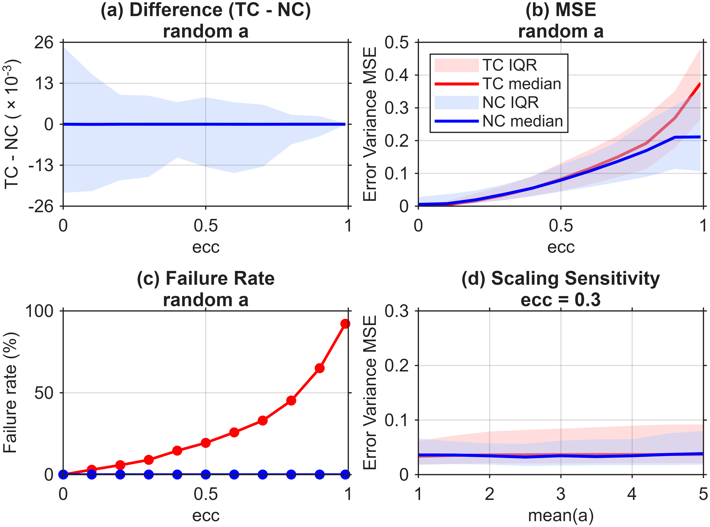

## Sim TCH vs NC results

[PDF](Sim_TCH_vs_NC_results.pdf)

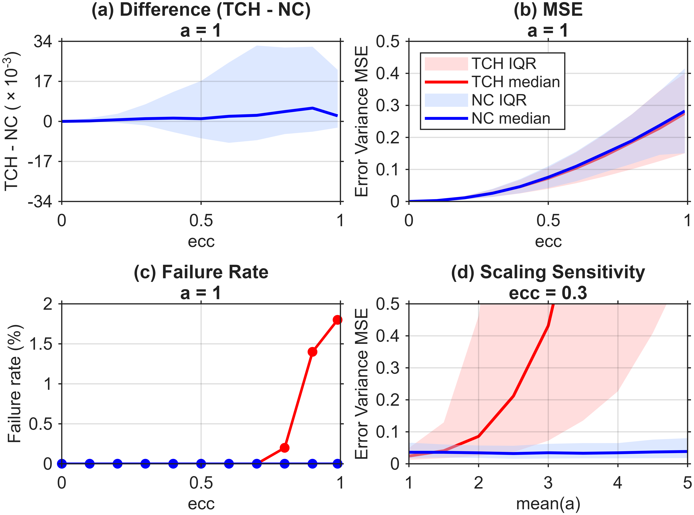

## Test NC Sensitivity results

[PDF](Test_NC_Sensitivity_results.pdf)

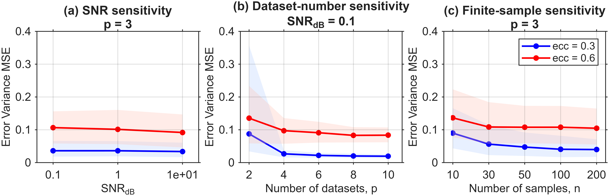

## Sim WA Comparison

[PDF](Sim_WA_Comparison.pdf)

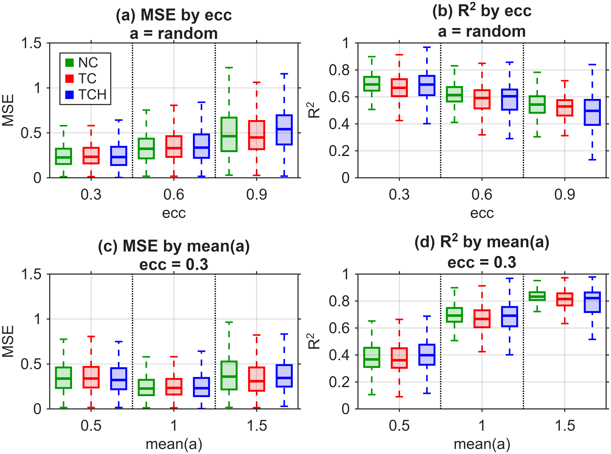

## Figure R1 Variance RMSE alpha 0

[PDF](Figure_R1_Variance_RMSE_alpha_0.pdf)

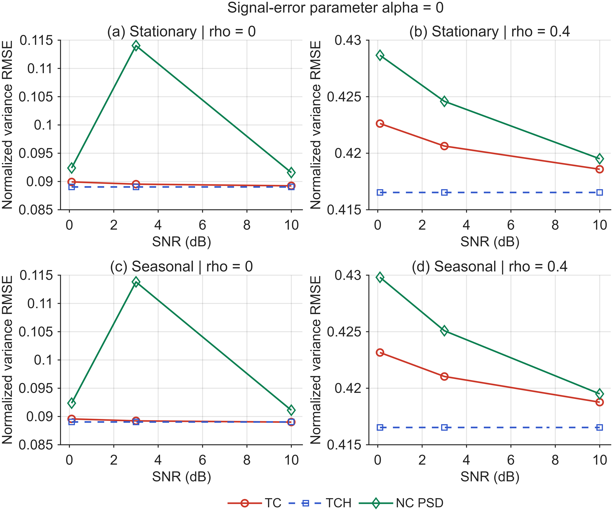

## Figure R1 Variance RMSE alpha 0p3

[PDF](Figure_R1_Variance_RMSE_alpha_0p3.pdf)

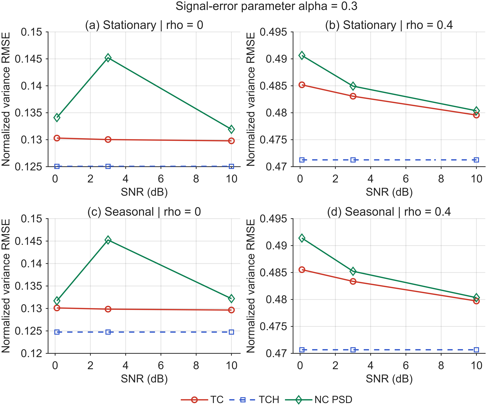

## Figure R2 Heldout Merging

[PDF](Figure_R2_Heldout_Merging.pdf)

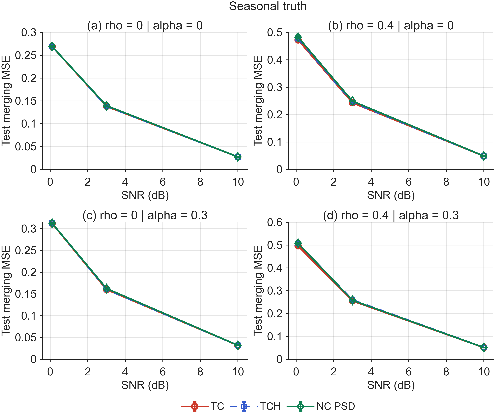

## Figure R3 Stress Feasibility and PSD Cost

[PDF](Figure_R3_Stress_Feasibility_and_PSD_Cost.pdf)

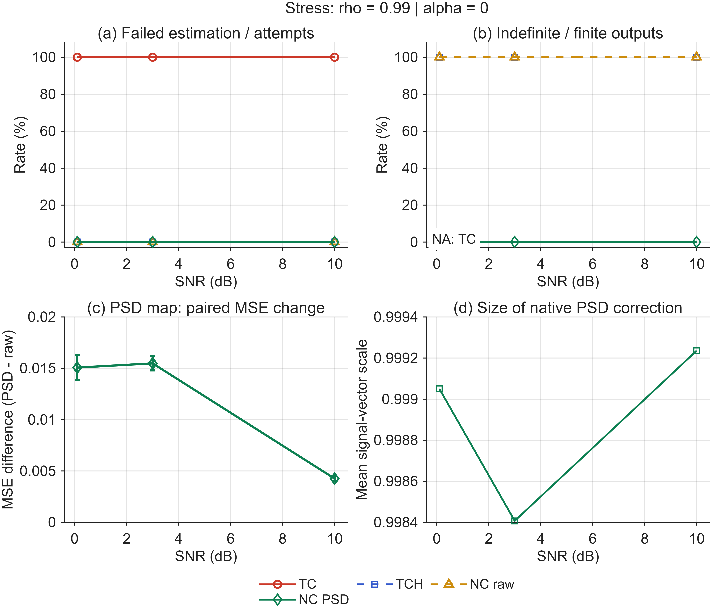

## Figure R4 Initialization and Eigenfloor

[PDF](Figure_R4_Initialization_and_Eigenfloor.pdf)

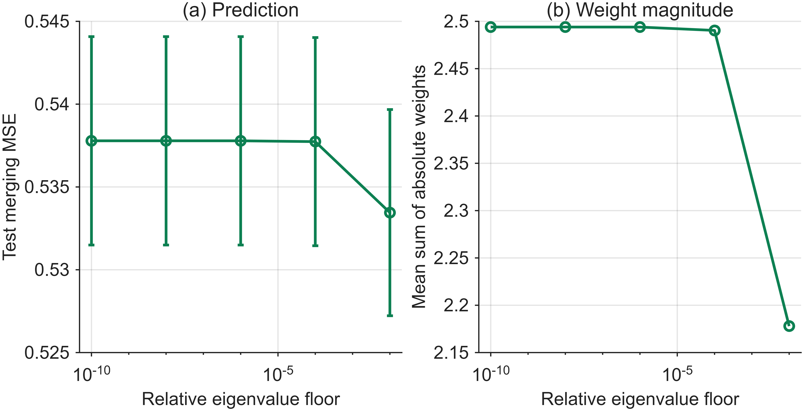

## Figure R4b Initialization

[PDF](Figure_R4b_Initialization.pdf)

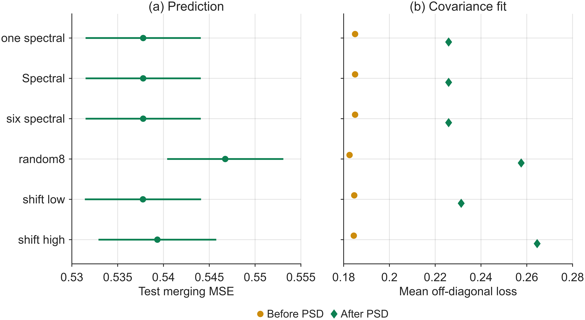

## Figure R5 Merging Controls

[PDF](Figure_R5_Merging_Controls.pdf)

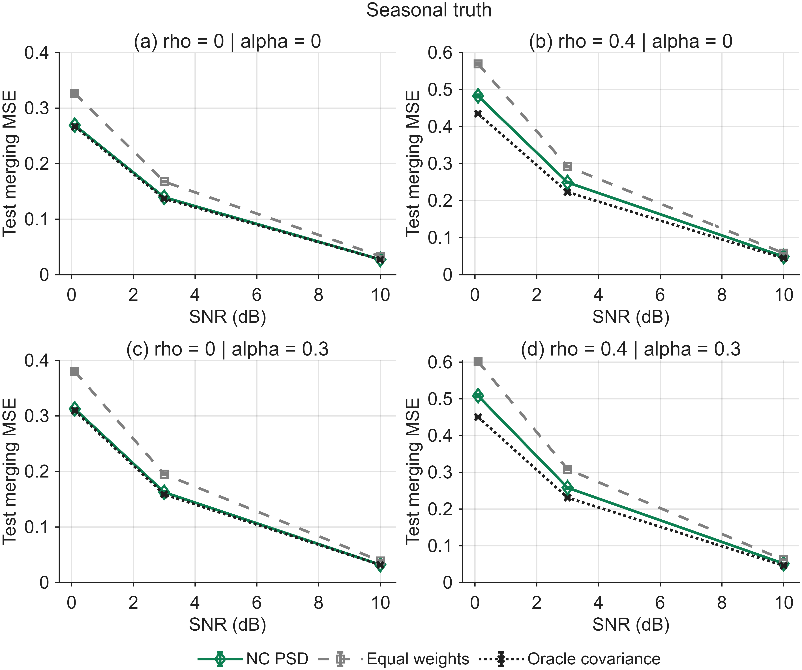

## Figure R6 Paired Seasonal Change

[PDF](Figure_R6_Paired_Seasonal_Change.pdf)

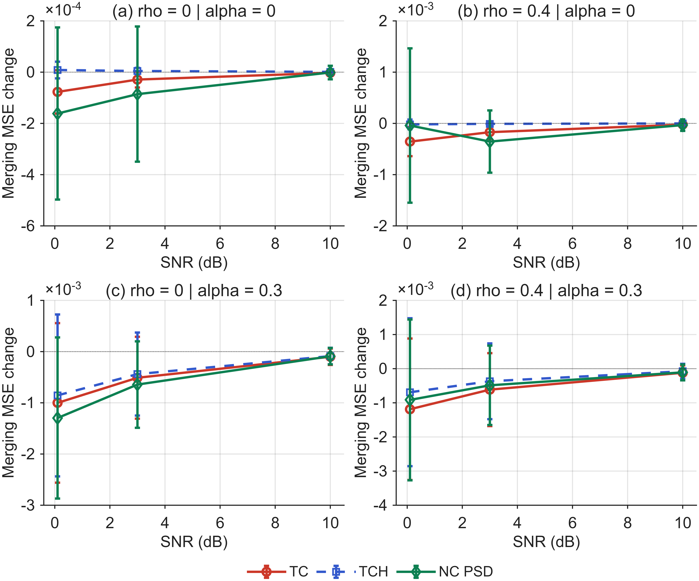

## Graphical Abstract NC

[PDF](Graphical_Abstract_NC.pdf)

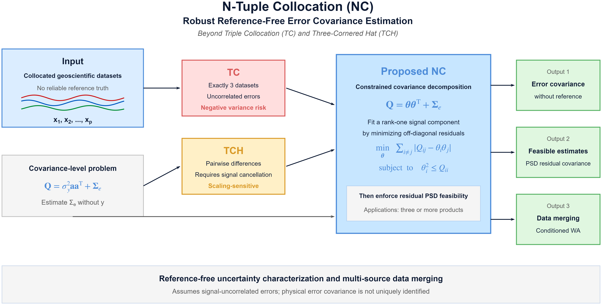

## FigS NC PSD Diagnostic

[PDF](FigS_NC_PSD_Diagnostic.pdf)

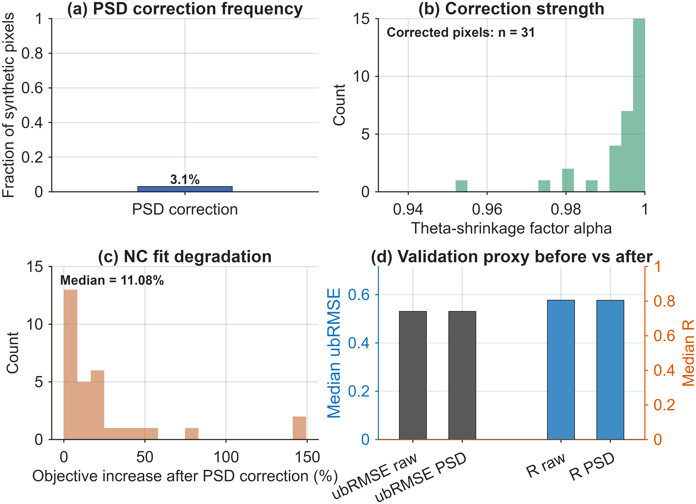
